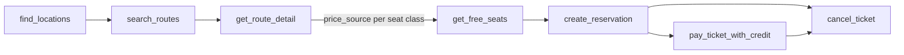

<div align="center">

# Regiojet MCP

An MCP server that lets AI assistants search, book and cancel RegioJet train and bus tickets.

[](https://pypi.org/project/regiojet-mcp)
[](https://pypi.org/project/regiojet-mcp)
[](pyproject.toml)
[](https://gofastmcp.com)
[](LICENCE)

</div>

## What is this?

A [FastMCP](https://gofastmcp.com) server for the [RegioJet Affiliate API](https://app.swaggerhub.com/apis/regiojet/affiliate/1.1.0).
It finds stations, searches connections and shows routes, prices and free seats. If you give it an account token, it
can also book tickets, pay for them from your RegioJet credit and cancel them.

## Quick Start

Run it from PyPI with [uvx](https://docs.astral.sh/uv/guides/tools/). You don't need a checkout.

**Claude Code**

```sh
claude mcp add regiojet -- uvx regiojet-mcp
# with account tools (booking, payment, cancellation):
claude mcp add regiojet -e REGIOJET_API_KEY=<token> -- uvx regiojet-mcp
```

**Other MCP clients** (Claude Desktop, Cursor, ...)

```json
{
  "mcpServers": {
    "regiojet": {
      "command": "uvx",
      "args": ["regiojet-mcp"],
      "env": { "REGIOJET_API_KEY": "<token>" }
    }
  }
}
```

Leave out `env` if you only need the read-only tools.

**Standalone**

```sh
uvx regiojet-mcp                                    # stdio
REGIOJET_MCP_TRANSPORT=http uvx regiojet-mcp        # http on 127.0.0.1:8000
```

## Tools

### Search and reference data

These tools are read-only and don't need a token.

| Tool | Description |
|---|---|
| `find_locations` | Resolve city/station names (any language, diacritics optional) to ids |
| `search_routes` | Connections between two locations on a date, paginated via `cursor` + `page` |
| `get_route_detail` | Sections (lines, platforms, transfers) and price per seat class |
| `get_free_seats` | Free seats per vehicle for a seat class |
| `list_tariffs`, `list_seat_classes`, `list_vehicle_standards`, `list_carriers`, `list_action_prices` | Reference data (cached) |
| `get_ticket` | Existing ticket by account code + ticket id |

### Account

These tools need `REGIOJET_API_KEY`.

| Tool | Description |
|---|---|
| `get_account` | Name, default tariff, credit balance |
| `list_my_tickets`, `get_my_ticket` | Tickets on the account, filterable by state |
| `create_reservation` | Reserve seats (UNPAID until paid, expires at `expiration_date`) |
| `pay_ticket_with_credit` | Pay UNPAID tickets from account credit (**spends money**) |
| `cancel_ticket` | Cancel a reservation or paid ticket (cancel charges may apply) |

### Resources

`regiojet://tariffs`, `regiojet://seat-classes`

### Booking flow



## Configuration

When you run it with `uvx`, set variables through your MCP client's `env`. When you run it from a checkout with `uv run`,
you can put them in a `.env` file in the server's working directory instead.

| Env var | Default | Notes |
|---|---|---|
| `REGIOJET_API_KEY` | unset | RegioJet customer account token (sent as Bearer). Enables account tools |
| `REGIOJET_USER` / `REGIOJET_PASSWORD` | unset | HTTP Basic auth for affiliate accounts. Ignored when `REGIOJET_API_KEY` is set |
| `REGIOJET_BASE_URL` | `https://brn-ybus-pubapi.sa.cz/restapi` | |
| `REGIOJET_LANG` | `en` | |
| `REGIOJET_CURRENCY` | `EUR` | |
| `REGIOJET_TIMEOUT` | `20` | Seconds |
| `REGIOJET_MCP_TRANSPORT` / `_HOST` / `_PORT` | `stdio` / `127.0.0.1` / `8000` | |

## Development

```sh
uv sync                                             # install with dev dependencies
uv run regiojet-mcp                                 # run from source (stdio)
REGIOJET_MCP_TRANSPORT=http uv run regiojet-mcp     # run from source (http)
uv run fastmcp dev inspector server.py              # MCP Inspector in the browser
uv run pytest                                       # tests
```

To use a local checkout in Claude Code:

```sh
claude mcp add regiojet -- uv run --directory /path/to/regiojet-mcp regiojet-mcp
```

### Project structure

```
regiojet-mcp/
├── src/
│   └── regiojet_mcp/
│       ├── __init__.py      # entry point, transport selection
│       ├── client.py        # async HTTP client for the RegioJet API
│       ├── config.py        # settings from environment
│       └── server.py        # MCP tools and resources
├── tests/
│   └── test_tools.py
├── fastmcp.json             # FastMCP project config
├── LICENCE
├── pyproject.toml
├── server.py                # entry point for `fastmcp run` / `fastmcp dev`
└── uv.lock
```

## License

[MIT](LICENCE) © Petr Václavek
